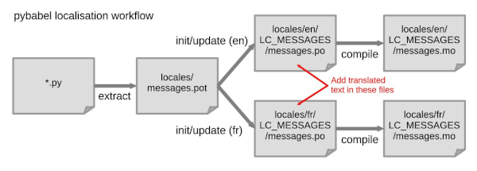

# PyGPSClient How to contribute

PyGPSClient is a volunteer project and we appreciate any contribution, from fixing a grammar mistake in a comment to extending test coverage or implementing new functionality. Please read this section if you are contributing your work.

If you're intending to make significant changes, please raise them in the [Discussions Channel](https://github.com/semuconsulting/pygpsclient/discussions/categories/ideas) beforehand.

Being one of our contributors, you agree and confirm that:

* The work is all your own. For the avoidance of doubt, this means **no AI coding agents such as Copilot** without clear attribution.
* Your work will be distributed under a BSD 3-Clause License once your pull request is merged.
* You submitted work fulfils or mostly fulfils our styles and standards.

Please help us keep our issue list small by adding fixes: #{$ISSUE_NO} to the commit message of pull requests that resolve open issues. GitHub will use this tag to auto close the issue when the PR is merged.

## Coding conventions

* This is open source software. Code should be as simple and transparent as possible. Favour clarity over brevity.
* Avoid external library dependencies (*especially those only available as source distributions*) unless there's a compelling reason not to.
* Avoid platform-specific methods (*be vigilant with tkinter window manager methods*).
* Code should be documented in accordance with [Sphinx](https://www.sphinx-doc.org/en/master/) docstring conventions.
* Code should formatted using [black](https://pypi.org/project/black/).
* We use and recommend [Visual Studio Code](https://code.visualstudio.com/) with the [Python Extension](https://marketplace.visualstudio.com/items?itemName=ms-python.python) for development and testing.
* We use and recommend [pylint](https://pypi.org/project/pylint/) for code analysis.
* We use and recommend [bandit](https://pypi.org/project/bandit/) for security vulnerability analysis.
* Commits must be [signed](https://docs.github.com/en/authentication/managing-commit-signature-verification/signing-commits).

## Testing

We use Python's native unittest framework for local unit testing, complemented by the GitHub Actions automated build and testing workflow.

Please write unittest examples for new code you create and add them to the `/tests` folder following the naming convention `test_*.py`.

## <a name="localisation">Adding Localisation Support</a>

PyGPSClient uses the standard native [gettext](https://docs.python.org/3/library/gettext.html) library for localisation. We use and recommend the [Python Babel](https://babel.pocoo.org/en/latest/) command line utilities (`pybabel`) to set up the necessary raw (`*.po`) and compiled (`*.mo`) message catalogs. Various VSCode tasks are provided to facilitate the workflow.

```shell
python3 -m pip install Babel
```



0. (**step only required if any source `*.py` files have changed**) To extract the message catalog template `messages.pot` from `src/*/*.py`:

   ```shell
   pybabel extract src --project PyGPSClient --output-file src/pygpsclient/locales/messages.pot --no-wrap
   ```

   (*or run the VSCode "Babel_Extract" task via Terminal..Run Task*)

1. To create or update a language message catalog `messages.po`:

   ```shell
   pybabel update -l <locale> --input-file src/pygpsclient/locales/messages.pot --output-dir src/pygpsclient/locales --init-missing --ignore-obsolete --update-header-comment
   ```

   where `<locale>` is the relevant locale code e.g. 'de', 'fr', 'es', etc.

   (*or run the VSCode "Babel_Update" task, having set the required `locale` code in `settings.json`*)

   This will update an existing `messages.po` text file in the `../<locale>/LC_MESSAGES` directory, or initialise a new file if none exists.

   Manually edit the `msgstr` entries in this file (or use a third-party PO file editor) to add the relevant string translations, and **raise a Pull Request to submit the changes**. Take care to ensure any Python braces {} are correctly transcribed
   in the translated string.

   ```
   #: src/pygpsclient/strings.py:58
   msgid "End of file reached"
   msgstr "Fin du dossier atteint"
   ```

   A simple Python script [translate_po.py](https://github.com/semuconsulting/PyGPSClient/blob/main/examples/translate_po.py) is available to machine translate messages.po files, but the results will invariably need refinement.

3. To compile the saved `messages.po` text files into runtime `messages.mo` binary files:

   ```shell
   pybabel compile --directory src/pygpsclient/locales --use-fuzzy
   ```

   (*or run the VSCode "Babel_Compile" task*)

4. To set the runtime localisation code:

   ```shell
   export PYGPSCLIENT_LOCALE=<locale> # where <locale> is the relevant locale code e.g. 'de', 'fr', 'es', etc.
   ```

## Submitting changes

Please send a [GitHub Pull Request to PyGPSClient](https://github.com/semuconsulting/PyGPSClient/pulls) with a clear list of what you've done (read more about [pull requests](https://docs.github.com/en/free-pro-team@latest/github/collaborating-with-issues-and-pull-requests/about-pull-requests)). Please follow our coding conventions (below) and make sure all of your commits are atomic (one feature per commit).

Please use the supplied [Pull Request Template](https://github.com/semuconsulting/pygpsclient/blob/main/.github/pull_request_template.md).

Please sign all commits - see [Signing GitHub Commits](https://docs.github.com/en/authentication/managing-commit-signature-verification/signing-commits) for instructions.

Always write a clear log message for your commits. One-line messages are fine for small changes, but bigger changes should look like this:

    $ git commit -m "A brief summary of the commit
    > 
    > A paragraph describing what changed and its impact."

Thanks,

semuadmin